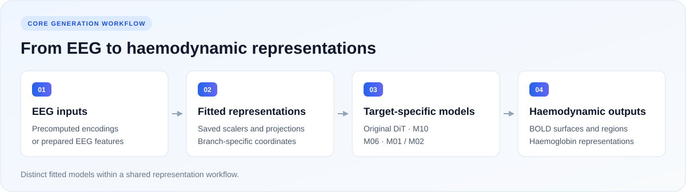

<div align="center">

# UnifiedNeuroGen

**EEG-conditioned generation of haemodynamic representations**

Core implementations accompanying the manuscript<br><em>A generative framework for unified representations bridging<br>electrophysiological and haemodynamic brain activity</em>

[](https://github.com/xkoo115/UnifiedNeuroGen/actions/workflows/tests.yml) [](https://github.com/xkoo115/UnifiedNeuroGen/releases/tag/v0.2.0) [](pyproject.toml)

[Quick start](#quick-start) · [Models](#models) · [Documentation](#documentation) · [Citation](#citation)

</div>

<p align="center">
  
</p>

## Overview

UnifiedNeuroGen provides the generation core for mapping EEG to BOLD and haemoglobin representations. The release brings together the original diffusion implementations and the target-specific generators used in the revised work, with portable interfaces for model fitting, saved transformations and inference.

- **Generation core.** Original BOLD/Hb DiT, revised M10 and M06 models, and M01/M02 regional generation primitives.
- **Real CPU demo.** A historical M10 checkpoint and 48 prepared EEG examples, distributed in a separate **8.7 MB** [demo Release](https://github.com/xkoo115/UnifiedNeuroGen/releases/tag/v0.2.0).
- **Method correspondence.** Explicit model identities, input formats and links between implementations and manuscript results.

The shared element is the representation workflow; individual implementations retain their own target coordinates and fitted weights. See [method and result correspondence](docs/methods.md) for the experimental details.

## Quick start

### 1. Install

Use **Python 3.10+**. The small demo runs on a CPU; the original full DiT models are intended for GPU use and require substantially more memory.

```bash
git clone https://github.com/xkoo115/UnifiedNeuroGen.git UnifiedNeuroGen
cd UnifiedNeuroGen
python -m venv .venv
source .venv/bin/activate
python -m pip install -e .
```

Validated package versions are recorded in [the environment reference](docs/validated_environment.txt).

### 2. Download the demo

Data and checkpoints are available as [v0.2.0 Release attachments](https://github.com/xkoo115/UnifiedNeuroGen/releases/tag/v0.2.0), separately from the code repository. From the repository root:

```bash
curl -fL --retry 3 -o UnifiedNeuroGen-demo.zip \
  https://github.com/xkoo115/UnifiedNeuroGen/releases/download/v0.2.0/UnifiedNeuroGen-demo.zip
curl -fL --retry 3 -o UnifiedNeuroGen-demo.zip.sha256 \
  https://github.com/xkoo115/UnifiedNeuroGen/releases/download/v0.2.0/UnifiedNeuroGen-demo.zip.sha256
shasum -a 256 -c UnifiedNeuroGen-demo.zip.sha256
unzip UnifiedNeuroGen-demo.zip -d ..
```

On Linux, `sha256sum -c UnifiedNeuroGen-demo.zip.sha256` is an alternative checksum command. Keep the extracted demo beside the repository:

```text
parent/
├── UnifiedNeuroGen/          # Code repository
└── UnifiedNeuroGen-demo/     # Data, transformations and checkpoint
```

### 3. Run generation

From the repository root:

```bash
python -m unifiedneurogen demo \
  --data-dir ../UnifiedNeuroGen-demo \
  --output outputs/demo
```

The demo verifies its SHA-256 manifest, loads the historical **M10 fold-01 seed-7** checkpoint, and generates conditional means and Gaussian samples from 48 real EEG feature vectors. Means are also projected to the 5,124-value prepared surface coordinates. EEG alone supplies the input at inference.

Expected fields in `outputs/demo/report.json`:

```json
{
  "status": "PASS",
  "samples": 48,
  "latent_shape": [48, 64],
  "surface_shape": [48, 5124],
  "target_required_at_inference": false
}
```

Generated arrays are saved to `outputs/demo/generated.npz`. CPU computation takes approximately one second on the validated machine, excluding installation and startup. For another run, use a fresh output directory, such as `--output outputs/demo_second_run`.

The outputs use run-centred, preprocessed target coordinates and do not restore removed run means. This small example demonstrates the generation interface; it does not estimate the manuscript's aggregate metrics.

## Models

| Implementation | Input → generated output | Role |
| --- | --- | --- |
| [BOLD DiT](src/unifiedneurogen/dit.py) | Surface EEG encodings → BOLD surface values through DDIM | Original EEG-to-fMRI diffusion generator |
| [Hb DiT](src/unifiedneurogen/gdit.py) | EEG encodings → stacked haemoglobin tokens through DDIM | Original EEG-to-Hb diffusion generator |
| [M10](src/unifiedneurogen/m10.py) | 2,928 EEG log-power coordinates → a conditional Gaussian over 64 target PCA coefficients | Revised BOLD generator; checkpoint included in the demo |
| [M06](src/unifiedneurogen/hb.py) | 1,575 EEG response features → 144 Hb mean/slope coordinates | Pooled EEG projection with MI/MA-specific response heads |
| [M01 / M02](src/unifiedneurogen/linear.py) | Prepared EEG histories → regional BOLD dynamics/scale coordinates | Generation primitives and saved-head inference |

M10 uses a conditional Gaussian model, M06 generates response summaries, and the original diffusion models use their own encoded inputs. [Methods](docs/methods.md) documents their relationship to the revised figures. This core release covers generation; downstream decoding, retrieval, significance testing and figure-production drivers are outside its scope.

## Training and generation

The CLI accepts prepared arrays and explicit configuration files. Choose an implementation below to view its commands. [Data formats](docs/data.md) specifies array names, shapes and preprocessing boundaries. Outputs must be new files or empty directories.

<details>
<summary><strong>M10 · Generate from the demo checkpoint or fit a small example</strong></summary>

Generate from EEG alone with the supplied checkpoint:

```bash
python -m unifiedneurogen m10-sample \
  --eeg ../UnifiedNeuroGen-demo/samples.npz \
  --transform ../UnifiedNeuroGen-demo/transforms/fold_transform.npz \
  --checkpoint ../UnifiedNeuroGen-demo/weights/m10.pt \
  --config configs/m10.json \
  --output outputs/m10_generated.npz
```

Fit a new model using the example's original sample roles and saved fitting transformations:

```bash
python -m unifiedneurogen m10-train \
  --data ../UnifiedNeuroGen-demo/samples.npz \
  --transform ../UnifiedNeuroGen-demo/transforms/fold_transform.npz \
  --config configs/m10.json \
  --epochs 2 --batch-size 16 \
  --output outputs/m10_training
```

This small refit uses a newly fitted Ridge anchor, four fitting-derived target states and a user-specified fixed Ridge penalty. It demonstrates training. The historical checkpoint was fitted on its original full fitting cohort.

</details>

<details>
<summary><strong>Original DiT · Train and sample BOLD or Hb representations</strong></summary>

The following commands use your own prepared arrays:

```bash
python -m unifiedneurogen dit-train \
  --data paired_encodings.npz --config configs/dit_fmri.json \
  --device cuda --output outputs/dit_training

python -m unifiedneurogen dit-sample \
  --eeg eeg_encodings.npy --checkpoint outputs/dit_training/dit.pt \
  --config configs/dit_fmri.json --steps 50 --device cuda \
  --output outputs/dit_generated.npz
```

For the original Hb model, add `--branch hb` and use `configs/dit_hb.json` in both commands. The full original diffusion checkpoint and upstream EEG encoders are not included in the small demo. A reduced random model for checking the DDPM/DDIM software path is configured in `configs/dit_smoke.json`; it carries no scientific performance claim.

</details>

<details>
<summary><strong>M06 · Fit and generate haemoglobin response summaries</strong></summary>

Use your own prepared Hb/EEG arrays with a fixed configuration:

```bash
python -m unifiedneurogen hb-train \
  --data hb_pairs.npz --config configs/hb.json --output outputs/hb_training
python -m unifiedneurogen hb-sample \
  --data hb_eeg.npz --checkpoint outputs/hb_training/hb.joblib \
  --output outputs/hb_generated.npz
```

</details>

For detailed options, run `python -m unifiedneurogen <command> --help`.

## Documentation

| Resource | What it covers |
| --- | --- |
| [Methods and result correspondence](docs/methods.md) | Model definitions, objectives and manuscript figure boundaries |
| [Data formats](docs/data.md) | Prepared arrays, shapes and preprocessing requirements |
| [Original DiT interfaces](docs/original_dit_interfaces.md) | Encoded inputs, checkpoints and portable diffusion interfaces |
| [Validated environment](docs/validated_environment.txt) | Package versions used for release verification |
| [Configurations](configs/) | Example settings for diffusion, M10 and Hb generation |

## Validation

```bash
python -m pip install -e '.[test]'
python -m pytest -q
```

Tests cover denoising and DDIM sampling, Gaussian likelihoods, learned temporal weights, fitting/inference boundaries and target transformations. Release verification also compares the real demo's deterministic means against saved historical predictions. Production-scale retraining and complete figure reproduction are outside these checks.

## Citation

If you use this code, please cite the accompanying manuscript. The repository's [citation metadata](CITATION.cff) records the manuscript and software version.

```bibtex
@unpublished{yao2026unifiedneurogen,
  title  = {A generative framework for unified representations bridging
            electrophysiological and haemodynamic brain activity},
  author = {Yao, Weiheng and Jing, Changhong and Chen, Xuhang and
            Wei, Xunbin and Zhang, Shihua and Pun, Chi-Man and
            Ng, Michael Kwok-Po and Wang, Shuqiang},
  year   = {2026},
  note   = {Manuscript}
}
```

## Data and licences

The demo contains derivatives of [NATVIEW](https://fcon_1000.projects.nitrc.org/indi/retro/nat_view.html), distributed with attribution under **CC BY 4.0**. Its README records preparation, original participant roles and checkpoint identity.

The original project's [MIT licence](LICENSE) is retained. Incorporated third-party material keeps its own terms, including **CC BY-NC 4.0** for Meta DiT portions. See [third-party notices](THIRD_PARTY_NOTICES.md) and [upstream licences](licenses/) for attribution and terms.

## Earlier implementation

The original implementation and its Git history remain available in the [legacy backup repository](https://github.com/xkoo115/UnifiedNeuroGen-legacy-backup-20261017) and the [pre-update snapshot](https://github.com/xkoo115/UnifiedNeuroGen/tree/legacy-before-npj-20261017). This repository retains the code address cited in the manuscript.
